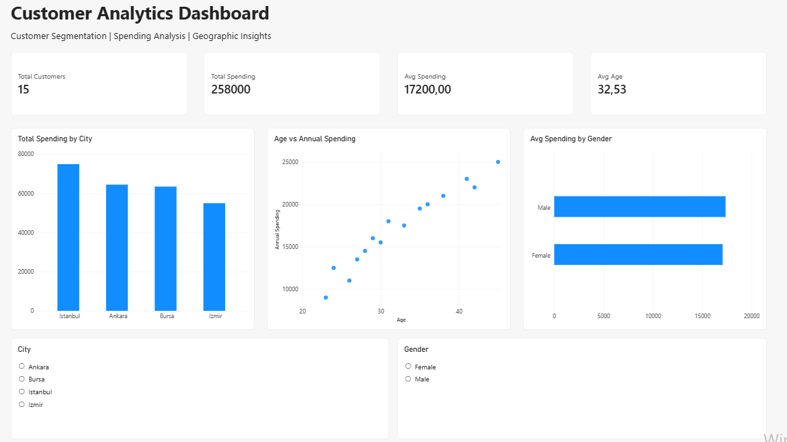

# Customer Analytics Dashboard | Power BI

## Project Overview

An interactive Customer Analytics Dashboard developed using Microsoft Power BI to analyze customer demographics, spending behavior, and key business performance indicators.

## Dashboard Preview



## Key Features

- Total customer count
- Total and average customer spending
- Average customer age
- Customer distribution by age group
- Customer spending analysis by city
- Interactive city filter
- KPI tracking and data visualization

## Tools & Technologies

- Microsoft Power BI
- DAX (Data Analysis Expressions)
- Data Modeling
- Data Visualization
- Data Analysis

## DAX Measures

```dax
Total Customers = DISTINCTCOUNT(customers[Customer_ID])

Total Spending = SUM(customers[Annual_Spending])

Avg Spending = AVERAGE(customers[Annual_Spending])

Avg Age = AVERAGE(customers[Age])
